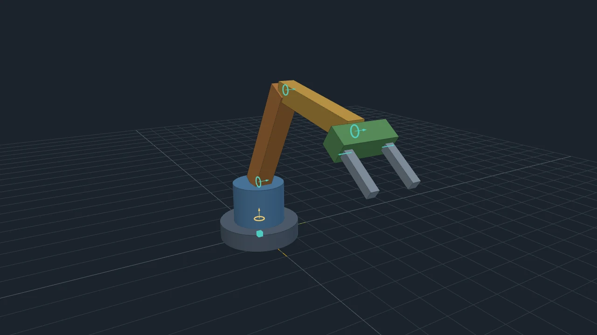

# Konjugate Robotics Toolbox

Draw a robot, and get a [Konjugate](https://github.com/zenineasa/Konjugate) model of it. A simple CAD-like window: place solids, click a point on one solid and a point on another to join them, say how they join and what drives each joint, and press Build. In the canvas, **each solid is a node and each joint is an edge between two solids**, so the robot can be wired to motors, batteries, controllers and anything else Konjugate models, then run, driven with sliders, forked, fitted and optimised. The robot moves by its joints' own equations (Featherstone's articulated-body method, split along the joints), which Konjugate's engine runs like any other: nothing outside the graph solves it, and every equation can be read and edited on its edge in the canvas.



## Status

Early development; where it is going and why: [docs/direction.md](docs/direction.md). What works today:

- **The Robotics window.** Boxes, cylinders, spheres and capsules, sized, placed and turned by typing or by handles in the 3D view, each of a material (its mass from its density) or a mass given. The Join tool: click a point on the first solid (or the floor, for the Ground) and a point on the second; the second turns and moves so the two points meet, faces together (Shift-click leaves it where it is). Points snap to face centres and edge middles. Hinge, slider, ball and fixed joints, with limits, damping, friction and armature (a hinge's or a slider's limits and dry friction held as MuJoCo holds them), and a drive: free, a torque, or a position servo with its setpoint, stiffness, damping and most torque. Checks say what stops a build and what to know, each pointing at its part. Undo and redo for everything; every action by button, by gesture and by key, on Windows, Linux and macOS. A joint can also be driven by a DC motor and gearbox on the robot's battery, its controller following a setpoint; the motor can be set by name from its datasheet (a Feetech STS3215, say) and the battery to a supply, and Servos to motors turns a robot's servos into such motors, holding as they held, so an imported arm can be sized on the servos it really has. A battery sags under load by its internal resistance and a supply past its most current; a smart servo's protection comes with it, so Size says when a run would have made it turn itself off, and the checks say when the battery gives more volts than a motor takes. A jog panel poses the robot with a slider per driven joint, to set setpoints or record keyframes: poses in time that the joints' setpoints follow. Import robot… (`I`) brings in a robot from a MuJoCo model: one of MuJoCo Menagerie's arms (its licence shown before anything is downloaded, its files kept on this computer, pinned to one commit) or a model's files from disk. Each body becomes a solid with the model's own look, mass and inertia, each joint a joint with its range, damping and armature, each position actuator a servo and each motor a torque drive; a model's fixed tendons (with their springs, damping, dry friction, limits and servos) and joint equalities come in as tendons and couplings; what the drawing cannot hold yet (contact, spatial tendons, other equality constraints, other actuators) is listed as it comes in, and undo brings the drawing back. A body with several joints comes in as a chain of links with no mass, one after each joint but its last. Menagerie's UR5e, SO-ARM100 and Panda (its fingers' tendon and equality too) run in Konjugate as in MuJoCo, without contact, to rounding (see docs/direction.md). Couple (`U`) holds one joint to a polynomial of another, and Tendon (`T`) runs a tendon over the selected joints, each with its card. Size (`M`) asks whether the motors will do it: Konjugate runs the robot as drawn, and each motor's card shows where it worked on the band of torque and speed it can give at its joint (at a full battery and an empty one), how much of the run it gave all it could, its most torque, speed and current and how hot its winding got against the hottest it may get, with a verdict, and what the run took from the battery. A what-if forks that run from a time with one thing changed (a heavier solid, a weaker motor or a tired battery) and shows it beside the run as drawn; Show in canvas opens both, a branch each. Eight examples to start from: a pendulum, a two-link arm on a waist, a cart carrying two pendulums, an arm with a two-finger gripper, the same arm on motors keyframed through a pick-and-place cycle, a four-bar linkage, a pendulum on two ball joints, and a crank driving a block along a rail. The drawing is kept with the project.
- **Build into the canvas.** The Ground, a node per solid (its joint's speed, position, acceleration and torque; its pose as `x`, `y`, `z`, `roll`, `pitch`, `yaw` and a rotation matrix; its energy; its shape at true size) and an edge per joint carrying the joint's equations, with its settings as parameters (the drive's torque or setpoint a live slider). Each solid's mass is a shared parameter, a live slider, as are each motor's torque constant and the battery's voltages: what the what-ifs change, from a time, in a fork of the run. A ball joint's solid holds its joint's angular velocity and its turn (a quaternion), and a ball is driven like the others, by a torque about each axis or a servo to a turn, with a most turn as its limit; a solid joined to nothing hangs from the Ground by an edge of its own, a free joint, and falls; and a joint that closes a loop (a four-bar's last pin, a slider's rail, a weld) is an edge holding what its kind holds, any number of loops to a robot, with its force, moment, gap and twist as states of the solid it holds. A joint's damping is taken at the step's end speed, as MuJoCo takes it, so heavy damping on a light link stays stable. A motor is a node of its own (its supply voltage, duty cycle, current, torque and winding temperature) with relationships to the battery (a node with its voltage and charge) and to its joint's solid; the keyframes are each driven joint's setpoint, a shared parameter with the keyframes as its schedule. Pose Visualizer shows the robot moving.
- **Checked** against an independent Newton-Euler solution of the same drawing, agreeing to within 1e-9, and against MuJoCo run on its own where it is installed: to rounding (about 1e-11) for a tree of hinges and sliders, and within a millimetre for ball joints, a falling body and closed loops, which the two step slightly differently. A robot imported from a model runs as MuJoCo runs the model's own file, to about 1e-12.
- **Not yet:** contact (so a gripper cannot yet pick a part up: the pick-and-place example carries its part fixed to the hand, and a robot imported from a model has none either); a motor driver's current limit and a winding's inductance (a supply's most current is modelled, a driver's is not); URDF, and STL and STEP parts; a model's spatial tendons, other equality constraints and joint springs. See the milestones in [docs/direction.md](docs/direction.md).

## Installing

The toolbox needs Konjugate 1.2.0 or newer (`minimumKonjugateVersion` in `package.json`), plus the features listed under `requires` in `packages/toolbox/addon.json`. With an older Konjugate it installs but shows no Robotics button. A released toolbox is signed and listed in Konjugate's registry (`registry/konjugate.robotics.json`), so it installs from **Extensions → Discover** inside Konjugate. To try the current source instead, see [Building from source](#building-from-source).

## Documentation

- [docs/direction.md](docs/direction.md): where the toolbox is going and why, how a drawing becomes nodes and edges, and the milestones.
- [docs/interaction.md](docs/interaction.md): how the window behaves for newcomers, regular users and power users, with every action's button, gesture and key.
- [AGENTS.md](AGENTS.md): a map of the code and the conventions for working in this repository.

## Running a robot

Build, then run the model in the canvas. Nothing else is needed: no Python, no simulator. The run's step is set in the window (a millisecond by default); stiff servos on light solids need a shorter one.

## Building from source

This repository builds against a sibling checkout of Konjugate (`KONJUGATE_DIR` overrides that), with its engine built for the engine tests. Konjugate loads the toolbox only when it is at least `minimumKonjugateVersion` in `package.json`; `install:dev` warns when the checkout is older, since the toolbox is then installed but has no button:

```
npm run build            # out/konjugate.robotics.toolbox-<version>.kja
npm run install:dev      # builds and installs it into your local Konjugate, removing the retired Robotics Engine plugin
npm test                 # unit tests
npm run test:interaction # builds, then drives the window in the real Konjugate app (its Electron, through Playwright), as a Windows or Linux user and as a Mac user
npm run test:engine      # drawn robots through Konjugate's engine, against a Newton-Euler reference
npm run setup:python     # optional: .venv with MuJoCo (needs uv), so test:engine also compares with MuJoCo alone
```

## Releasing

As for Konjugate's other add-ons: push a tag `v<version>` matching `package.json`'s version, and `.github/workflows/release.yml` tests, builds, signs (with the `ROBOTICS_SIGNING_PRIVATE_KEY` secret) and verifies the toolbox against Konjugate's `registry/konjugate.robotics.json`, then publishes it as `konjugate.robotics.kja`. `.github/workflows/build.yml` makes an unsigned build, run by hand. Release Konjugate first when the toolbox needs something new from it (`minimumKonjugateVersion`).

## Licence

[AGPL-3.0](LICENSE). MuJoCo (Apache-2.0) is used only by the tests, from the developer's own install, and is not shipped. three.js (MIT) is vendored in `packages/toolbox/vendor/` with its licence.
